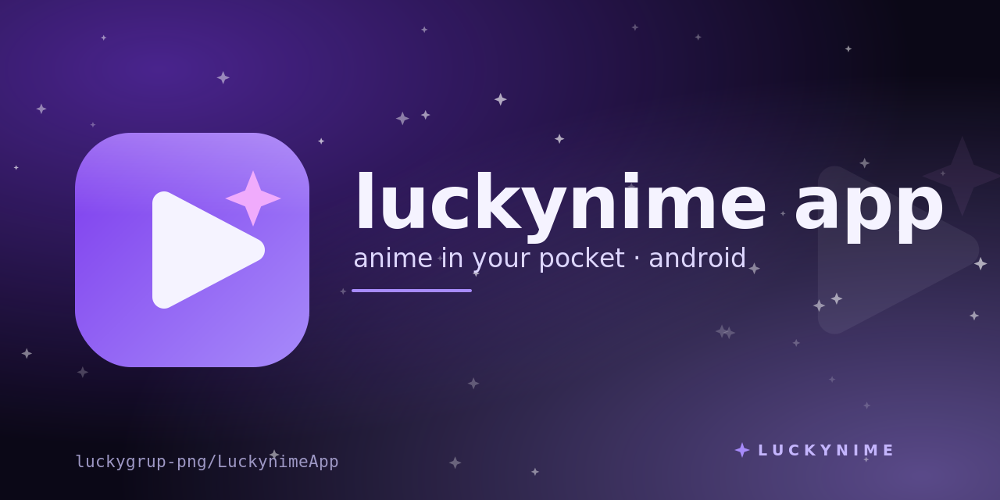

<div align="center">



<br>

<a href="https://github.com/luckygrup-png/LuckynimeApp/releases/latest">
  
</a>
<a href="https://github.com/luckygrup-png/LuckynimeApp/releases/latest">
  
</a>


<h1>luckynime app</h1>
<p><i>streaming anime sub indonesia, langsung di kantong kamu</i></p>

<a href="https://github.com/luckygrup-png/LuckynimeApp/releases/latest"><b>⬇ Download APK</b></a>
&nbsp;·&nbsp;
<a href="https://github.com/luckygrup-png/luckynime">Web</a>
&nbsp;·&nbsp;
<a href="https://github.com/luckygrup-png/Luckynime-Dashboard">Dashboard</a>

</div>

---

## ✦ Tentang

**Luckynime App** adalah aplikasi streaming anime Android resmi dari ekosistem
[**Luckynime**](https://github.com/luckygrup-png) — satu klik install, langsung nonton.
Dibangun dengan Expo + React Native dan native playback layer.

### Yang bikin beda

| Fitur | |
|---|---|
| Multi-provider & server fallback chain | satu sumber down, lanjut otomatis |
| Skip Intro/Outro (AniSkip) | langsung ke episode |
| Download / offline | tonton tanpa kuota |
| Subtitle kustom | font, size, background, outline |
| MAL / AniList sync | progres tersimpan |
| Episode notifications | notif rilis stream-verified |
| Watch statistics + recommendations | tahu apa yang kamu tonton |
| PiP, sleep timer, 2× hold, gestures | kontrol penuh saat nonton |

## 📦 Install

1. Buka [**Releases**](https://github.com/luckygrup-png/LuckynimeApp/releases/latest)
2. Download `arm64` (umum), `arm32`, atau `universal`
3. Install — kalau diminta, aktifkan *install dari sumber tidak dikenal*

> Android 9.0+ · Universal APK berisi semua arsitektur

## 🛠️ Build dari source

```bash
pnpm install
pnpm dev        # development
pnpm build      # build server
pnpm start      # jalankan hasil build
```

Baca [CONTRIBUTING.md](CONTRIBUTING.md) sebelum membuka PR.

## 🌌 Ekosistem Luckynime

| Project | Deskripsi |
|---|---|
| [**luckynime**](https://github.com/luckygrup-png/luckynime) | Web experience utama |
| [**dunia luckynime**](https://github.com/luckygrup-png/Dunia-Luckynime) | Dunia interaktif (React + Supabase) |
| [**luckynime api**](https://github.com/luckygrup-png/Luckynime-API) | REST API anime sub Indo |
| [**nuepet zoo**](https://github.com/luckygrup-png/NuePet-Zoo) | 3D floating-island pet sanctuary |
| [**luckynime dashboard**](https://github.com/luckygrup-png/Luckynime-Dashboard) | Admin portal & Mobile APK |

## ⚖️ License & Catatan

Kode sumber: **MIT License**. Nama **Luckynime**, logo, dan ikon **tidak** di-cover lisensi —
jangan mendistribusikan salinan yang mengatasnamakan Luckynime.

Hanya streaming konten yang kamu punya hak untuk tonton.

---

<div align="center">
<sub>Built with 💜 by <b>Lucky Developer</b> — <code>@lukyy</code> · part of the
<a href="https://github.com/luckygrup-png"><b>luckynime</b></a> ecosystem</sub>
</div>
